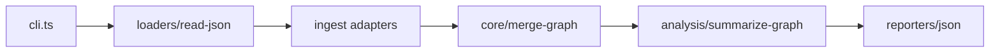

# hx-graph-cli — architecture

## Purpose

Reads one or more JSON files produced by HackerX tools (or compatible shapes), maps them
into a unified graph model (nodes + edges), and serializes merged output. Non-goals:
graph visualization UI or persistent graph database.

## High-level flow

## Module map

| Path                              | Responsibility                        |
| --------------------------------- | ------------------------------------- |
| `src/cli.ts`                      | Commander `merge`, `-o`, stderr stats |
| `src/loaders/read-json.ts`        | Parse JSON file paths                 |
| `src/ingest/subdomains.ts`        | hx-dns style subdomain lists          |
| `src/ingest/alive.ts`             | hx-alive probe results                |
| `src/ingest/hosts.ts`             | Plain host lists                      |
| `src/ingest/findings.ts`          | Generic finding records               |
| `src/core/merge-graph.ts`         | Combine ingested fragments            |
| `src/utils/node-id.ts`            | Deterministic node keys               |
| `src/analysis/summarize-graph.ts` | Node/edge counts                      |
| `src/reporters/json.ts`           | Canonical graph JSON                  |
| `src/merge.ts`                    | Public merge API barrel               |

## Extension

1. Add `src/ingest/<tool>.ts` detecting a new JSON envelope shape.
2. Register the adapter in `merge-graph.ts` (type guard + node/edge emission).
3. Add fixture JSON under `tests/` and unit tests — no network.
4. Run `npm test` and `npm run format:check`.

## Testing strategy

- **Unit**: ingest modules, merge, node-id, loaders (`*.spec.ts`).
- **Integration**: `tests/merge.test.ts` multi-file fixtures.

## Ethics & scope

Authorized engagements only. See [SECURITY.md](./SECURITY.md).
